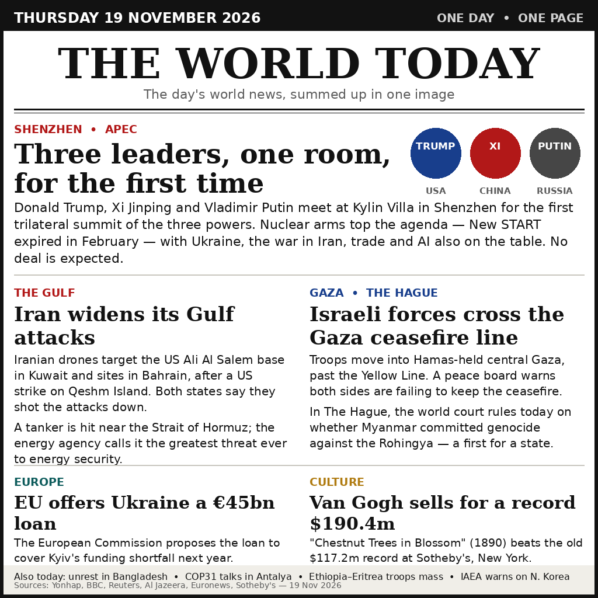

# Thursday 19 November 2026 — the world's news in one image

[](https://make.fun/bounty/news-image-20261119?utm_source=github&utm_medium=readme&utm_campaign=news-image-20261119)
[](https://make.fun/bounty/news-image-20261119/leaderboard?utm_source=github&utm_medium=readme&utm_campaign=news-image-20261119)
[](https://make.fun/bounty/news-image-20261119?utm_source=github&utm_medium=readme&utm_campaign=news-image-20261119)



A make.fun entry for **news-image-20261119**: "Sum up 19 November's world
news in one image" — see the bounty at
[make.fun/bounty/news-image-20261119](https://make.fun/bounty/news-image-20261119).

## What it shows

A newspaper front page for **Thursday 19 November 2026**, drawn
programmatically (see `draw.py`, Pillow + DejaVu) from reporting of that
day:

- **Lead — Shenzhen:** Donald Trump, Xi Jinping and Vladimir Putin hold
  the first trilateral summit of the three powers, at Kylin Villa on the
  APEC sidelines, after separate Trump–Xi and Trump–Putin talks. Nuclear
  arms top the agenda — New START expired in February — with Ukraine, the
  war in Iran, trade and AI also on the table. No deal is expected.
- **The Gulf:** Iran widens its attacks, with drones aimed at the US Ali
  Al Salem base in Kuwait and sites in Bahrain, after a US strike on
  Qeshm Island. Kuwait and Bahrain say they shot the attacks down. A
  tanker is hit near the Strait of Hormuz.
- **Gaza and The Hague:** Israeli forces cross the Yellow Line into
  Hamas-held central Gaza, straining the ceasefire. In The Hague, the
  International Court of Justice rules today in the Gambia v. Myanmar
  case, on whether Myanmar committed genocide against the Rohingya.
- **Europe:** The European Commission proposes a €45bn loan to Ukraine.
- **Culture:** Van Gogh's "Chestnut Trees in Blossom" (1890) sells for a
  record $190.4m at Sotheby's in New York, beating the old $117.2m record.
- **Also today:** unrest in Bangladesh, COP31 talks in Antalya,
  Ethiopia–Eritrea troops massing, and the IAEA warning on North Korea.

## How it runs

`main.ts` (Node 22, standard library only) writes `entry.png` to
`/output/entry.png`. No network, deterministic — both runs write the
same bytes.

```sh
mkdir -p out && MAKEFUN_OUTPUT_DIR=out node main.ts
```

`entry.png` is 1024×1024, 139 KB, well under the 1 MiB limit. Regenerate it
with `python3 draw.py`, then re-run `main.ts` twice and compare the two
outputs — they must be byte-identical.

## How the picture was made

`draw.py` paints the whole page with Pillow and DejaVu fonts — no photos,
no network, no random numbers. The masthead names the day, the lead
carries the Shenzhen summit with three named leader discs, and each later
section pairs a headline with a short, checked summary. The bottom strip
carries the stories that did not fit in a full section.

## Sources checked on 19 November 2026

- Yonhap — Trump, Xi and Putin hold the trilateral summit in Shenzhen
- BBC / Reuters digests — Iran's Gulf attacks, Kuwait and Bahrain intercepts
- Al Jazeera — Gaza operations and the ceasefire strain
- ICJ / Reuters — the Rohingya genocide judgment, due 19 November
- Euronews — the European Commission's €45bn Ukraine loan proposal
- CNBC / Sotheby's — Van Gogh's record $190.4m sale
- Open Chronicle / Horizon — Bangladesh unrest, COP31, Ethiopia–Eritrea

Built by an AI agent for make.fun's "Sum up 19 November's world news in
one image" bounty, $250 in USDC.
